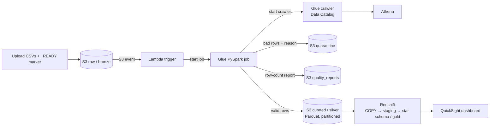
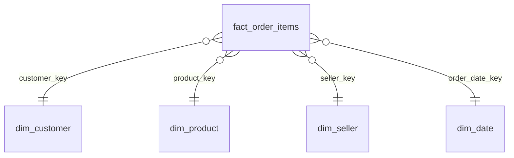

# Olist E-commerce Analytics Pipeline on AWS

A batch data pipeline that turns raw e-commerce CSVs into a validated data lake and a star-schema warehouse:
**S3 → Lambda → Glue (PySpark) → Athena / Redshift → QuickSight**, provisioned with **Terraform** and tested in **GitHub Actions**.

Built on the public [Olist Brazilian E-Commerce dataset](https://www.kaggle.com/datasets/olistbr/brazilian-ecommerce) (orders, items, customers, products, sellers).

## Architecture



| Layer | Where | What happens |
|---|---|---|
| Bronze | `s3://<lake>/raw/<table>/` | CSVs exactly as received, never modified |
| Silver | `s3://<lake>/curated/<table>/` | Typed, deduplicated, validated Parquet. `orders` is partitioned by purchase year and month |
| Gold | Redshift schema `dw` | Star schema for BI |

## Data model (grain: one row per order item)



Measures: `price`, `freight_value`, `item_total`, `delivery_days`, `delivery_delay_days` (positive means late).

## Data quality

Every table goes through the same gate. Bad rows are never silently dropped.

| Check | Examples | Result |
|---|---|---|
| Required keys present | `order_id`, `product_id`, `seller_id` | Row goes to quarantine with the rule name |
| Value rules | non-negative price, valid order status, 2-letter state, purchase timestamp parses | Quarantine |
| Duplicates | same key twice | One row kept (deterministic), count reported |
| Referential integrity | item → order, product, seller; order → customer | Orphans to quarantine (a quarantined order also quarantines its items) |
| Reconciliation | `raw = duplicates + quarantined + valid` | Reported per table in `quality_reports/` |
| Publish gate | share of quarantined rows above `max_bad_ratio` (default 5%) | Job fails and the previous curated data stays untouched |

## Repo layout

```
src/glue/clean_transform.py   PySpark job (logic is plain functions, unit tested without AWS)
src/lambda/trigger_glue.py    starts the job when raw/_READY appears
infra/                        Terraform: S3, IAM, Glue job + crawlers, Athena, Lambda, budget alert, optional Redshift
sql/redshift/                 schema, COPY, staging → star schema, analytics queries
sql/athena/                   CSV vs Parquet scan comparison, ad-hoc queries
scripts/                      upload_raw.py, run_local.py, make_sample_data.py
tests/                        unit tests (Spark local) + schema contract test
.github/workflows/            CI (tests, terraform validate, secret scan) and manual deploy
docs/design_decisions.md      why each choice was made
```

## Run it locally (no AWS needed)

Requires Python 3.10+ and Java 11 or 17.

```bash
pip install -r requirements-dev.txt
pytest -q                         # unit tests + contract test
python scripts/run_local.py       # runs the pipeline on synthetic sample data with planted defects
```

`data/sample/` is **synthetic** (generated by `scripts/make_sample_data.py`), not Olist data. It contains
deliberate defects so you can see the duplicates, orphans and bad values land in `output/quarantine/`.

## Deploy on AWS

Prerequisites: an AWS account, Terraform ≥ 1.5, AWS CLI configured, the Olist CSVs from Kaggle.

```bash
cd infra
cp terraform.tfvars.example terraform.tfvars      # set alert_email
terraform init && terraform apply
cd ..

# 1. Upload data; the _READY marker starts Lambda → Glue
python scripts/upload_raw.py --bucket $(terraform -chdir=infra output -raw lake_bucket) --src ~/Downloads/olist

# 2. Watch the Glue job run (Glue console or CloudWatch). Its report is in s3://<lake>/quality_reports/
# 3. The job starts the curated crawler. Start the raw crawler once to enable the CSV vs Parquet comparison:
aws glue start-crawler --name olist-pipeline-raw

# 4. Query in Athena: sql/athena/queries.sql
# 5. Warehouse: set enable_redshift = true and a password (TF_VAR_redshift_admin_password), terraform apply,
#    then run sql/redshift/01 → 04 in Redshift query editor v2
# 6. QuickSight: connect to Redshift (or Athena) and build the dashboard from sql/redshift/04_analytics.sql
```

**Tear down when you finish a session:** `terraform -chdir=infra destroy`. Redshift and Glue runs cost money.

### Cost controls built in
- Monthly budget alert (`alert_email`, fires at 80% of `monthly_budget_usd`)
- Athena workgroup cap of 1 GB scanned per query
- Redshift is off by default (`enable_redshift = false`)
- Glue job: 2 workers, 30-minute timeout, no retries, one concurrent run
- Lifecycle rule deletes Athena results after 7 days

## Results (fill in from your own run)

| Metric | Value |
|---|---|
| Orders / order items loaded | _…_ / _…_ |
| Rows quarantined (per table, by rule) | _from quality_reports_ |
| Glue job runtime | _…_ |
| Athena data scanned, raw CSV (Jan 2018 orders) | _…_ |
| Athena data scanned, curated Parquet (same question) | _…_ |
| Redshift: fact rows vs staged items | _…_ |

Screenshots to add under `docs/screenshots/`: Glue run, Athena "data scanned", Redshift query, QuickSight dashboard.

## Limitations and next steps
- Full reload on every run. Next step: incremental loads using the order-month partitions.
- Dimensions are SCD Type 1 (overwrite). Type 2 is described in `docs/design_decisions.md`.
- Batch only. Streaming (Kinesis) is out of scope.
- Payments, reviews and geolocation tables are not modelled yet.
- Orchestration is event-driven (Lambda). A Step Functions or Airflow DAG would add retries and dependencies.

## Data
Olist data is not included. Download it from Kaggle and check its license terms before redistributing anything.
